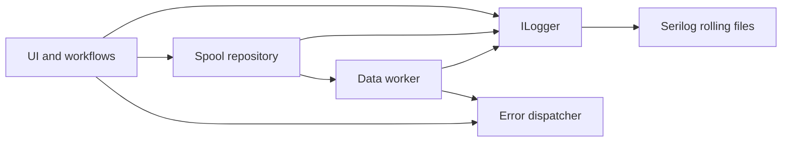

# Requirements

### Logging scope
- Record application startup and shutdown, database initialization and failures, inventory and order workflows, import/export, and printing/document generation.
- Log important outcomes at information level, recoverable problems at warning level, and failures with exceptions at error level. Reserve per-operation tracing for debug level.
- Preserve existing UI error reporting and behavior. Distinguish accepted in-memory changes from database commits, and never describe a canceled print/save as successful.
- Keep the existing asynchronous `Log/log.txt` daily rolling files, three-file retention, and debug console behavior. Do not explicitly log inventory contents, user-selected paths, or document data; exception messages and stack traces may still contain sensitive details.

# Technical Design

### Approach
Use the existing `ILogger<T>` dependency injection and `[LoggerMessage]` structured-message pattern in `SpoolRepository` and `AppManager`. Assign stable event IDs and operation/count fields; include logger category in file output. Keep the existing Serilog minimum levels, so debug messages are not expected in normal information-level files.

### File Structure
- `Reimpl/CelloManager.Avalonia/AppServiceProvider.cs` and `Bootstrapper.cs`: configure contextual output and log lifecycle; include repository initialization in protected shutdown/flush handling, including failures after the logger is available.
- `CelloManager.Data/CelloManager.Data.csproj` and `DataOperationManager.cs`: reference the logging abstraction, inject `ILogger<DataOperationManager>`, and log worker lifecycle, migration, commit and failure boundaries. Preserve `DatabaseWorkitem.ErrorReporter` delivery and queue semantics. Add a narrowly scoped temporary-database test seam if needed without changing the production database path.
- `Reimpl/CelloManager.Avalonia/Core/Data/SpoolRepository.cs`: log initialization counts and debug-level queued cache changes, not persistence success.
- `Reimpl/CelloManager.Avalonia/Core/Logic/SpoolManager.cs` and `OrderManager.cs`: log import/export outcomes and accepted inventory/order actions without recording model contents. Existing returned exceptions and behavior remain unchanged.
- `Reimpl/CelloManager.Avalonia/Core/Printing/PrintBuilder.cs` and `Core/Printing/Steps/DocumentTypeSelector.cs`: log workflow start, selector cancellation, normal termination, and failures. Normal termination is not labeled a successful print, because a later save dialog may be canceled.
- `Reimpl/CelloManager.Avalonia/ViewModels/MainWindowViewModel.cs` and other active error-forwarding view models: log exceptions caught locally that have not already been logged at their source. Keep `ErrorDispatcher` notifications unchanged and avoid duplicate exception records.
- `Reimpl/CelloManager.Avalonia.Tests/CelloManager.Avalonia.Tests.csproj`: reference the application/data projects and replace the linked serializer source with the application reference. Add focused logging tests and an in-memory capturing logger under the existing test project.

### Architecture

### Risks
- `SpoolRepository` updates its cache before asynchronous persistence; logs must not claim durability until `SaveChangesAsync` completes.
- The async sink must be flushed after queued database work stops, even if initialization or worker shutdown fails. Failures before the logging provider exists can only be reported on a best-effort basis.
- Import and printing may return normally after cancellation or partial work; log only observable outcomes.

# Testing

### Automated validation
- Run `dotnet build CelloManager.sln` and `dotnet test Reimpl/CelloManager.Avalonia.Tests/CelloManager.Avalonia.Tests.csproj`; the test project is not currently in the solution.
- Capture structured log events with a test logger and assert levels, event IDs, exceptions, and the absence of explicitly logged names or paths.
- Use an isolated temporary database to test migration, queued writes, failed work, error callbacks, and shutdown; never use the user's database.
- Check import/export failure reporting, order acceptance/no-op, lifecycle cleanup, document-selector cancellation, and normal workflow termination. Verify file-sink flushing and retention using temporary files where practical.

# Delivery Steps

###   Step 1: Instrument application lifecycle
Startup and shutdown produce contextual logs and flush pending events reliably.

- Update `AppServiceProvider.cs` to include logger category in file output while retaining existing destinations, levels, rolling, and retention.
- Update `Bootstrapper.cs` to log startup, initialization failure, and shutdown; protect repository initialization with cleanup and ensure provider disposal even if worker shutdown fails.
- Add focused lifecycle and temporary-file sink checks, including early initialization failure and flush behavior.

###   Step 2: Instrument database and repository
Database initialization, queued work, commits, and failures are distinguishable in logs.

- Inject `ILogger<DataOperationManager>` and add structured worker, migration, save, and exception events in `CelloManager.Data`.
- Preserve worker callbacks and existing queue behavior; use debug-level messages for frequent successful operations.
- Log repository initialization counts and queued changes without claiming they are committed.
- Extend the xUnit project with application/data references, a capturing logger, and isolated-database tests for saves, failures, callbacks, and shutdown.

###   Step 3: Instrument inventory and order workflows
Imports, exports, inventory changes, and order actions produce meaningful outcome logs.

- Add structured logging to `SpoolManager` and `OrderManager`, distinguishing accepted in-memory changes from persisted results.
- Preserve existing return values and exception handling, and avoid logging model contents or selected paths.
- Test successful and failed import/export paths, accepted and no-op order actions, event severity, and sensitive-field exclusions.

###   Step 4: Instrument printing and remaining error boundaries
Printing and UI-originated failures are logged without false success messages or duplicate exception records.

- Log printing start, document-selection cancellation, normal workflow termination, and failure in `PrintBuilder` and `DocumentTypeSelector`.
- Log locally caught exceptions in active UI error-forwarding paths only when their source has not already recorded them; preserve `ErrorDispatcher` behavior.
- Test cancellation, normal termination, exception forwarding, and duplicate avoidance; run the solution build and explicit test-project command.